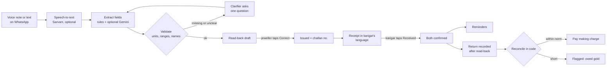

<div align="center">

# SwarnaSetu

### A gold job-work record that the jeweller and the karigar both confirm on WhatsApp

[](https://hackculture.io/hackathons/tech4bharat-gavs-hackathon)
[](#)
[](#)


</div>

> **Problem statement 2.2:** Gold given to karigars for job-work is tracked on trust, and disputes follow.

The jeweller sends a voice note like *“Gave Ramesh 50 grams 22K for 10 bangles, due Friday.”* SwarnaSetu reads it back, and nothing is saved until the jeweller taps **Correct**. The karigar then gets a receipt in Malayalam, Hindi or Bengali and taps **Received**. From then on both sides hold the same record. Reminders go out before the due date. On return day the gold is checked in code against the wastage they agreed, and the making charge is worked out.


---

## Run it

The repo ships with demo data (one Thrissur shop, four karigars, five jobs), so there is something to click straight away. **No API keys are needed.**

**Windows:** double-click `start.bat`. It sets up Python, builds the web app on first run and opens <http://localhost:8000>.

**macOS / Linux:**

```bash
./start.sh
```

**Docker:**

```bash
docker compose up --build
```

**By hand:**

```bash
# backend
cd backend
python -m venv .venv
.venv\Scripts\activate          # Windows  (macOS/Linux: source .venv/bin/activate)
pip install -r requirements.txt

# frontend (one-time build; FastAPI serves it)
cd ../frontend
npm install
npm run build

# run
cd ../backend
uvicorn app.main:app --reload
```

Needs Python 3.10+ and, to build the web app, Node.js 18+. For frontend development with hot reload, run `npm run dev` in `frontend/` and open <http://localhost:5173> (API calls are proxied to port 8000).

---

## Two-minute demo

1. Open **WhatsApp demo**. On the jeweller’s phone tap the example *“Gave Ramesh Das 12 grams 22K for 2 rings…”*.
2. Read the draft. Tap **Correct**.
3. On the karigar’s phone switch to **Ramesh Das**. The receipt arrives in **Bengali**. Tap **পেয়েছি** (Received). The jeweller’s phone says both sides now have the same record.
4. Tap *“Gave Anil 30 g for 4 rings…”*. Purity was not said, so SwarnaSetu asks for it with buttons.
5. Try the Malayalam note *“രമേശ് ദാസിന് 50 ഗ്രാം 22 കാരറ്റ് 10 വള, വെള്ളിയാഴ്ച”* or press the mic (Chrome/Edge) and speak.
6. Ask *“How much gold is with Ramesh?”*.
7. Open the job from **Job cards**, record the return (e.g. 11.42 g back, 0.1 g scrap) and watch the return check, then record payment.
8. Open **JC-1005** to see a short return (0.400 g owed), and **Delivery challan** for a printable job-work challan.
9. On the WhatsApp demo page, use **Move time forward** to run reminders as of a later date.


---

## How it works



**Plain code where the gold must add up, AI where the input is messy.** The ledger is a state machine in PostgreSQL/SQLite. AI only turns speech into a draft, and every number is confirmed by a person before it is saved.

| Layer | What it does | Type |
|---|---|---|
| Webhook / simulator | Same handlers for the built-in simulator and the real WhatsApp Cloud API; duplicate webhooks ignored | Code |
| Speech-to-text | Sarvam `saaras` with gold terms and karigar names as key terms; browser speech recognition as fallback | Applied AI |
| Extractor | Rule parser for English, Manglish, Malayalam, Hindi, Bengali; optional Gemini with a fixed JSON schema. AI numbers are kept only if the same number is in the note, and the rules win on disagreement | Applied AI + code |
| Validator | Unit conversion in code (pavan 8 g, tola 11.6638 g), range checks, per-piece weight sanity, past due dates | Code |
| Clarifier | Asks one question with buttons when the karigar, weight or purity is missing or ambiguous | Rules |
| Ledger | `draft → awaiting_karigar → confirmed → reconciled / flagged → paid`, with disputes and cancellation; every change in a hash-chained audit log | Code |
| Reconciliation | `balance = issued − (returned − stones) − scrap − agreed wastage`, integer milligrams | Code |
| Ledger Q&A agent | Read-only lookups answer questions; Lyzr agent or Gemini can phrase the answer from those facts | Agent |
| Exports | Printable delivery challan (Rule 55 style) and ITC-04-style CSVs | Code |

---

## Turning on the real services

Copy `.env.example` to `.env` and fill in only what you need. Everything else keeps working without it.

| Feature | Variables | Without it |
|---|---|---|
| Voice notes via Sarvam | `SARVAM_API_KEY` | Type, or use the browser mic (Chrome/Edge) |
| Gemini extraction help | `GEMINI_API_KEY` | Rule-based extraction |
| Lyzr Q&A agent | `LYZR_API_KEY`, `LYZR_AGENT_ID` | Ledger lookups answer directly |
| Real WhatsApp | `WHATSAPP_TOKEN`, `WHATSAPP_PHONE_NUMBER_ID`, `WHATSAPP_VERIFY_TOKEN` | Messages stay in the simulator |
| PostgreSQL | `DATABASE_URL=postgresql+psycopg://…` (and `pip install "psycopg[binary]"`) | SQLite file in `backend/data/` |

For WhatsApp, point the Meta webhook at `https://<your-server>/webhook/whatsapp`, set the shop owner’s number in **Settings**, and add each karigar’s number on the **Karigars** page.

---

## Project structure

```text
SwarnaSetu/
├── backend/
│   ├── app/
│   │   ├── main.py              # FastAPI app, serves the built frontend, reminder loop
│   │   ├── models.py            # tables (weights in mg, money in paise)
│   │   ├── seed.py              # demo shop, karigars and jobs
│   │   ├── api/routes.py        # REST API + WhatsApp webhook
│   │   └── services/
│   │       ├── parser.py        # voice/text → fields (5 languages)
│   │       ├── validator.py     # checks before the read-back
│   │       ├── ledger.py        # state machine and every job action
│   │       ├── goldmath.py      # exact reconciliation maths
│   │       ├── chat.py          # conversation engine (simulator and webhook)
│   │       ├── templates.py     # karigar messages in ml / hi / bn / en
│   │       ├── qa.py            # ledger Q&A agent
│   │       ├── reminders.py     # due-date reminders and nudges
│   │       ├── exports.py       # challan and ITC-04 CSVs
│   │       ├── audit.py         # hash-chained audit log
│   │       ├── stt.py, llm.py, whatsapp.py   # optional integrations
│   └── tests/                   # 22 tests: parser, gold maths, full job flow, webhook
├── frontend/src/                # React: dashboard, job cards, karigars, WhatsApp demo, settings
├── start.bat / start.sh         # one-step start
├── Dockerfile, docker-compose.yml
└── .env.example
```

## Main API endpoints

Interactive docs at <http://localhost:8000/docs>.

| Method | Path | Purpose |
|---|---|---|
| GET | `/api/dashboard` | Gold out, overdue, flags, karigar balances, activity |
| GET / POST | `/api/jobs` | List or create job cards |
| POST | `/api/jobs/{id}/confirm` · `/karigar-confirm` · `/return` · `/resolve` · `/pay` · `/extend` · `/cancel` | Job actions (state machine enforced) |
| GET | `/api/jobs/{id}/challan` | Printable delivery challan |
| POST | `/api/chat/jeweller/text` · `/api/chat/{party}/voice` · `/api/chat/button` | Simulator, same code as WhatsApp |
| POST | `/api/ask` | Ledger Q&A |
| POST | `/api/reminders/run` | Run reminders (optionally as of a date) |
| GET | `/api/export/itc04-sent.csv` · `/itc04-received.csv` | GST job-work exports |
| GET | `/api/audit/verify` | Check the audit hash chain |
| GET / POST | `/webhook/whatsapp` | Meta webhook verification and messages |

## Tests

```bash
cd backend
pip install -r requirements-dev.txt
pytest -q
```

---

## Before using this with real gold

This is a hackathon prototype. Known gaps:

- **No login yet.** Run it on your own machine for demos; add authentication before putting it on the internet.
- **One shop per install.** Multi-shop support is not built.
- **Translations** of karigar messages should be checked by native Malayalam, Hindi and Bengali speakers.
- **Unit values** (pavan, tola) and typical wastage ranges should be confirmed with local jewellers.
- **GST formats.** The challan and ITC-04 exports are drafts; check them with a CA and the GST portal’s offline tool.
- **WhatsApp outside 24 hours** needs Meta-approved utility templates for receipts and reminders.
- **Speech accuracy** on real workshop audio has not been measured yet; the plan is to test 30–50 real voice notes.
- **Dispute helper agent** (summarising a disputed job for the jeweller) is planned; today disputes use buttons and the job history.

## Ground validation

An interview with staff at a large Kerala jewellery chain found that jewellery is made both in-house and by outside karigars, branches work with roughly 15–100 karigars, large chains already use software but still see disputes over delays and making, and wastage depends on the type of work. So SwarnaSetu targets small and mid-size jewellers and lets each job carry its own agreed wastage.

## Team

| Name | Role | Links |
|---|---|---|
| **Ann Rose PT** | Team lead, full stack and AI | [GitHub](https://github.com/AnnRosePT) · [LinkedIn](https://linkedin.com/in/ann-rose-pt) · [Portfolio](https://ann-rose-pt007.vercel.app) |

B.Tech Computer Science and Engineering, Christ College of Engineering, Irinjalakuda, Kerala

<div align="center">

**SwarnaSetu:** every gram, agreed by both sides.

</div>
