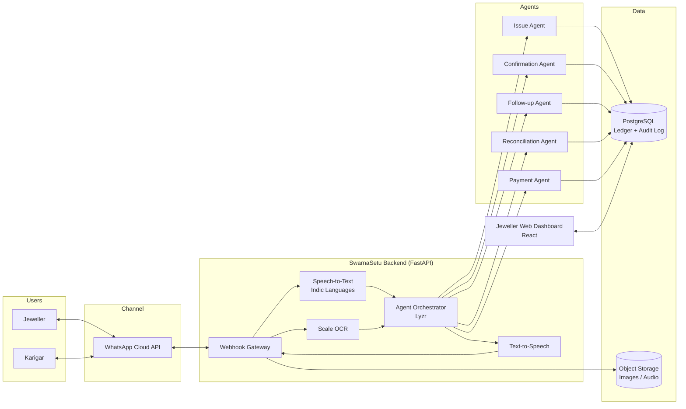
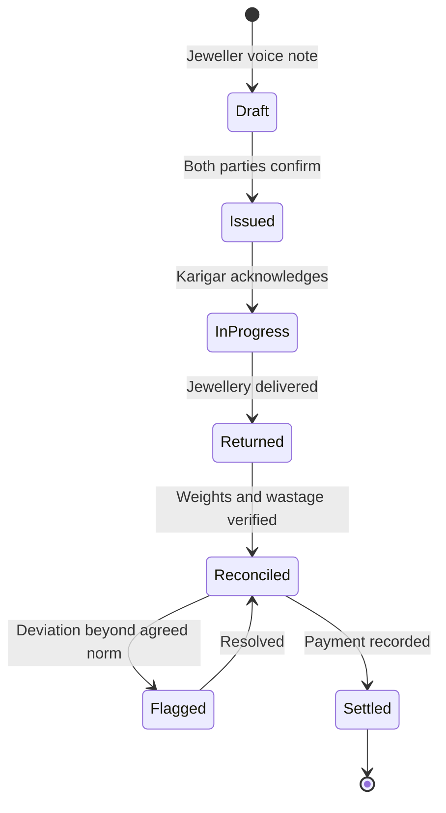
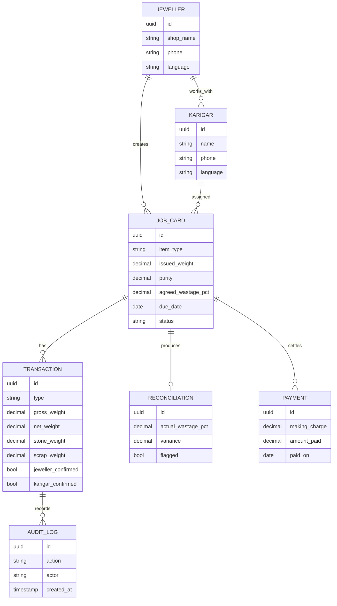

<div align="center">

# SwarnaSetu

### Voice-First Agentic AI Platform for Transparent Karigar Gold Tracking

[](https://hackculture.io/hackathons/tech4bharat-gavs-hackathon)
[](#)
[](#)
[](#)


</div>

---

## Table of Contents

- [Overview](#overview)
- [Problem Statement](#problem-statement)
- [Solution](#solution)
- [Key Features](#key-features)
- [System Architecture](#system-architecture)
- [Agent Workflow](#agent-workflow)
- [Tech Stack](#tech-stack)
- [Data Model](#data-model)
- [Project Structure](#project-structure)
- [Getting Started](#getting-started)
- [Ground Validation](#ground-validation)
- [Business Model](#business-model)
- [Roadmap](#roadmap)
- [Team](#team)

---

## Overview

**SwarnaSetu** (*"Bridge of Gold"*) digitises the gold job-work relationship between jewellers and karigars (goldsmiths). Instead of handwritten registers and verbal agreements, both parties interact with a multi-agent AI system through **WhatsApp voice notes in their own language**. Every issue, return, wastage check and payment becomes a **mutually confirmed, auditable record**.

> Submitted to **Tech4Bharat, the hackathon of the Global Accelerator Vision Summit (GAVS) 2026**, under the **Jeweltech** theme, Problem Statement **2.2**.

---

## Problem Statement

> **PS 2.2:** *Gold given to karigars for job-work is tracked on trust, and disputes follow.*

Jewellers routinely issue gold to in-house and external karigars for manufacturing. In small and mid-size jewellery businesses, this is commonly tracked through manual registers, phone calls and unstructured WhatsApp messages. This leads to:

| Pain Point | Impact |
|---|---|
| **Wastage and purity mismatches** | Returned gold or scrap does not match expected weight or purity |
| **Delivery delays** | Missed commitments, especially in wedding and festival seasons |
| **Making-charge disputes** | Disagreements over stone weight and additional design work |
| **One-sided records** | No shared, verifiable proof of what was issued or agreed |
| **Locked capital** | Gold held by karigars is high-risk working capital for small jewellers |

Karigars often have limited literacy and use low-cost smartphones, making conventional ERP or form-based software impractical.

---

## Solution

SwarnaSetu provides a **conversational, voice-first ledger** built on agentic AI:

```text
Jeweller (voice note):  "Gave Ramesh 50 grams 22K for 10 bangles, due Friday."

SwarnaSetu:             ✓ Job card JC-1042 created
                        ✓ Receipt sent to Ramesh in Malayalam
                        ✓ Awaiting karigar confirmation
                        ✓ Reminder scheduled for Thursday
```

No typing, no new app for karigars, and no record is final without confirmation from both parties.

---

## Key Features

- **Voice-to-Ledger Entry**: Regional-language voice notes converted into structured transactions
- **Dual Confirmation**: Records are finalised only after both jeweller and karigar approve
- **Job Card Lifecycle**: Issue → In Progress → Returned → Reconciled → Settled
- **Per-Job Wastage Norms**: Jeweller defines the agreed wastage for each job; the system flags deviations
- **Purity-Aware Reconciliation**: Tracks gross weight, net weight, stone weight, purity (touch) and scrap
- **Automated Follow-ups**: Due-date reminders and voice-based progress updates
- **Payment Settlement**: Making charges computed from agreed rates; monthly statements for both parties
- **Jeweller Dashboard**: Gold outstanding per karigar, overdue jobs, wastage trends, delivery performance
- **Immutable Audit Trail**: Complete, timestamped history for dispute resolution
- **Offline Tolerance**: Queued entries sync when connectivity is restored

---

## System Architecture



---

## Agent Workflow

| Agent | Responsibility | Input | Output |
|---|---|---|---|
| **Issue Agent** | Extracts transaction details from voice or text | Voice note, scale photo | Draft job card |
| **Confirmation Agent** | Sends localised receipts and collects approvals | Draft job card | Confirmed job card |
| **Follow-up Agent** | Tracks deadlines and progress | Job card due dates | Reminders, status updates |
| **Reconciliation Agent** | Validates returns against issued gold and agreed norms | Return weights, scrap, stones | Reconciliation report, alerts |
| **Payment Agent** | Computes making charges and settlements | Reconciled job card, rate card | Payment record, statements |



---

## Tech Stack

| Layer | Technology | Purpose |
|---|---|---|
| **Agent Framework** | Lyzr Agent Studio | Multi-agent orchestration and workflow automation |
| **LLM** | GPT-4o / Gemini (via Lyzr) | Structured extraction from transcribed speech |
| **Speech-to-Text** | Sarvam AI / Bhashini | Indic-language transcription (Malayalam, Tamil, Hindi, Bengali, etc.) |
| **Text-to-Speech** | Sarvam AI / Bhashini | Voice receipts and reminders for low-literacy users |
| **OCR** | Google Cloud Vision / Tesseract | Reading digital weighing-scale displays from photos |
| **Messaging** | Meta WhatsApp Cloud API | Primary user interface for jewellers and karigars |
| **Backend** | Python 3.11, FastAPI | REST API, webhook handling, business logic |
| **Task Queue** | Celery + Redis | Scheduled reminders and asynchronous processing |
| **Database** | PostgreSQL (Supabase) | Transactional ledger and audit log |
| **Object Storage** | Supabase Storage | Audio notes, scale photos, receipts |
| **Frontend** | React, Vite, Tailwind CSS | Jeweller dashboard |
| **Charts** | Recharts | Wastage and delivery analytics |
| **Auth** | Supabase Auth (phone OTP) | Secure jeweller login |
| **DevOps** | Docker, GitHub Actions | Containerisation and CI/CD |
| **Hosting** | Render (API), Vercel (Dashboard) | Cloud deployment |

---

## Data Model



---

## Project Structure

```text
SwarnaSetu/
├── backend/
│   ├── app/
│   │   ├── agents/            # Issue, Confirmation, Follow-up, Reconciliation, Payment
│   │   ├── api/               # REST endpoints and WhatsApp webhooks
│   │   ├── services/          # STT, TTS, OCR, messaging integrations
│   │   ├── models/            # Database models
│   │   ├── schemas/           # Pydantic schemas
│   │   └── core/              # Config, security, utilities
│   ├── tests/
│   └── requirements.txt
├── dashboard/
│   ├── src/
│   │   ├── components/
│   │   ├── pages/
│   │   └── services/
│   └── package.json
├── docs/
│   ├── architecture.md
│   └── validation-notes.md
├── docker-compose.yml
├── .env.example
└── README.md
```

---

## Getting Started

> The prototype is under active development. Setup instructions will be finalised with the first release.

### Prerequisites

- Python 3.11+
- Node.js 18+
- Docker and Docker Compose
- Meta WhatsApp Cloud API credentials
- Lyzr API key
- Sarvam AI / Bhashini API access

### Installation

```bash
# Clone the repository
git clone https://github.com/AnnRosePT/SwarnaSetu.git
cd SwarnaSetu

# Configure environment variables
cp .env.example .env

# Start all services
docker-compose up --build
```

### Environment Variables

```env
WHATSAPP_TOKEN=
WHATSAPP_PHONE_NUMBER_ID=
LYZR_API_KEY=
SARVAM_API_KEY=
DATABASE_URL=
REDIS_URL=
SUPABASE_URL=
SUPABASE_KEY=
```

---

## Ground Validation

An interview was conducted with a staff member at a large Kerala jewellery retail chain. Key findings:

| Finding | Design Decision |
|---|---|
| Jewellery is manufactured **both in-house and through external karigars** | Support both karigar types within a single ledger |
| Branches work with approximately **15–100 karigars** | Dashboard built for multi-karigar tracking at scale |
| Large chains already use **computerised systems** | Primary market: **small and mid-size jewellers** without ERP |
| Disputes still occur over **delays and making** | Dedicated Follow-up Agent and dual confirmation |
| **Wastage varies by type of work**; no fixed rate | Configurable **per-job wastage norms** instead of fixed tables |

Further interviews with independent jewellers and karigars in Thrissur are planned.

---

## Business Model

| Segment | Offering | Pricing Model |
|---|---|---|
| Small jewellers | Core ledger, voice entry, confirmations | Monthly subscription (entry tier) |
| Mid-size jewellers | Multi-karigar dashboard, analytics, payments | Monthly subscription (growth tier) |
| Karigars | Receipts, confirmations, work history | **Free** |
| Associations | Bulk onboarding and member access | Partnership pricing |

**Growth levers:** free trial for adoption, verified karigar profiles, HUID and stock-record integration, and work-history-based credit enablement for artisans.

---

## Roadmap

- [x] Problem research and ground validation
- [x] Solution architecture and idea submission
- [ ] WhatsApp webhook and voice transcription pipeline
- [ ] Issue and Confirmation agents
- [ ] Reconciliation and wastage-deviation engine
- [ ] Payment settlement and monthly statements
- [ ] Jeweller dashboard (MVP)
- [ ] Pilot with local jewellers in Thrissur, Kerala

---

## Team

| Name | Role | Links |
|---|---|---|
| **Ann Rose PT** | Team Lead, Full-Stack and AI | [GitHub](https://github.com/AnnRosePT) · [LinkedIn](https://linkedin.com/in/ann-rose-pt) · [Portfolio](https://ann-rose-pt007.vercel.app) |

B.Tech Computer Science and Engineering, Christ College of Engineering, Irinjalakuda, Kerala

---

<div align="center">

**SwarnaSetu**: Building trust in every gram.

*Built for Tech4Bharat · GAVS 2026*

</div>
